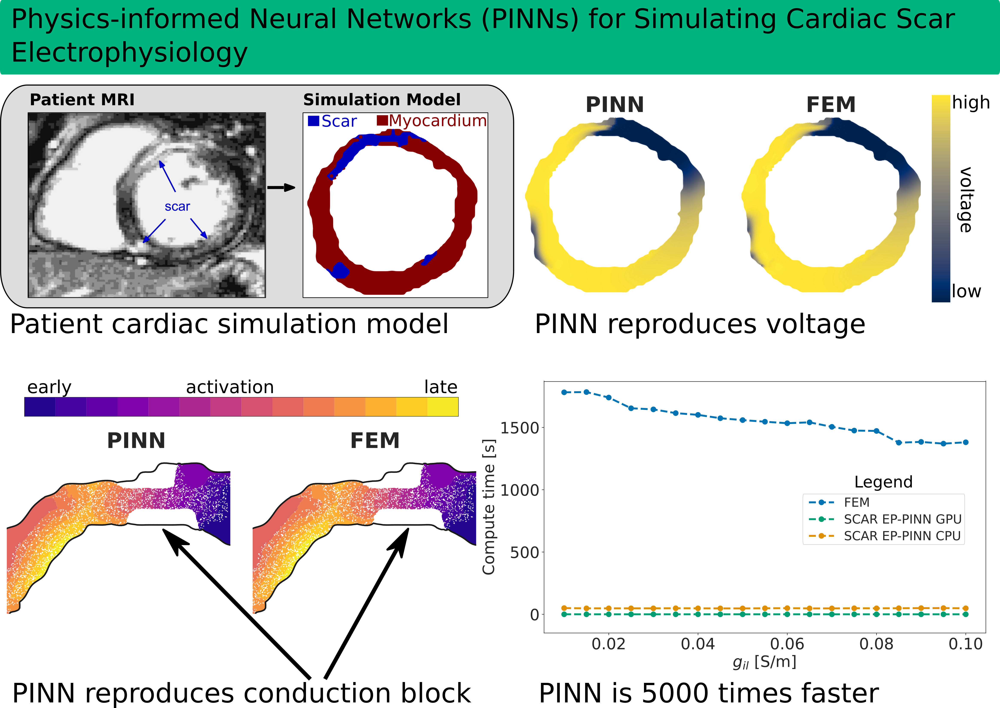

# Scar Electrophysiology Physics-Informed Neural Network (SCAR EP-PINN)
¨SCAR EP-PINN is a physics-informed neural network framework for simulating the electrophysiology of cardiac scars in 2-D image slices. It was developed and tested using a late-gadolinium contrast enhanced MRI image.

Fig. 1: Overview of SCAR EP-PINN

## Dependencies 
>h5py = 3.10.0
>
>matplotlib = 3.5.1
>
>numpy = 1.24.3
>
>pandas = 1.3.5
>
>seaborn = 0.13.2
>
>torch = 2.8.0
>
>tqdm = 4.40.0

## How to get the FEM data
SCAR-EP PINN is trained on data generated using the finite element method (FEM). You can download the FEM training data
from the Zenodo repository ....

## How to get the pretrained model weights and baises
A pretrained model is available under

`experiments/run_20250429_191929/final_model.pth`

## How to train the PINN from scratch yourself
Run the training script

> python3 train_pinn.py

